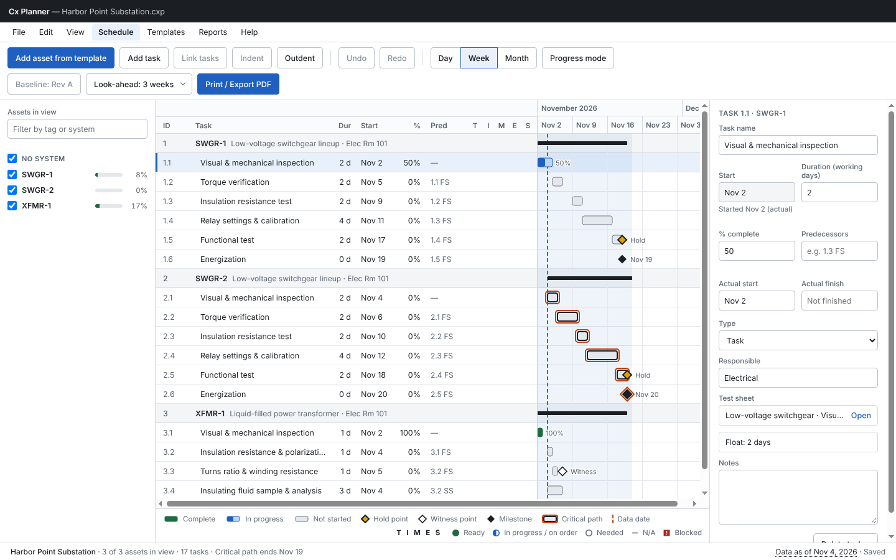
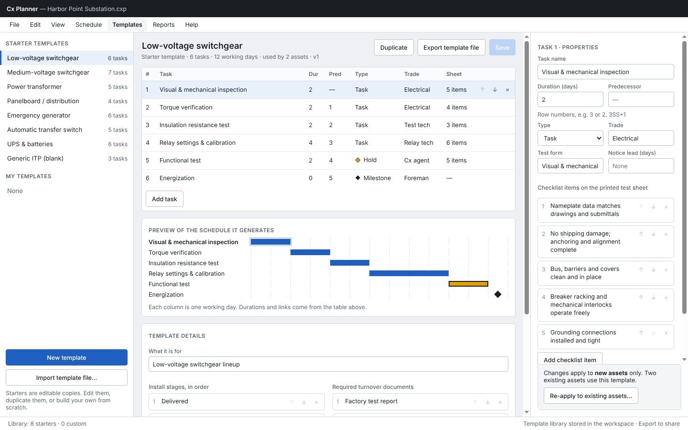
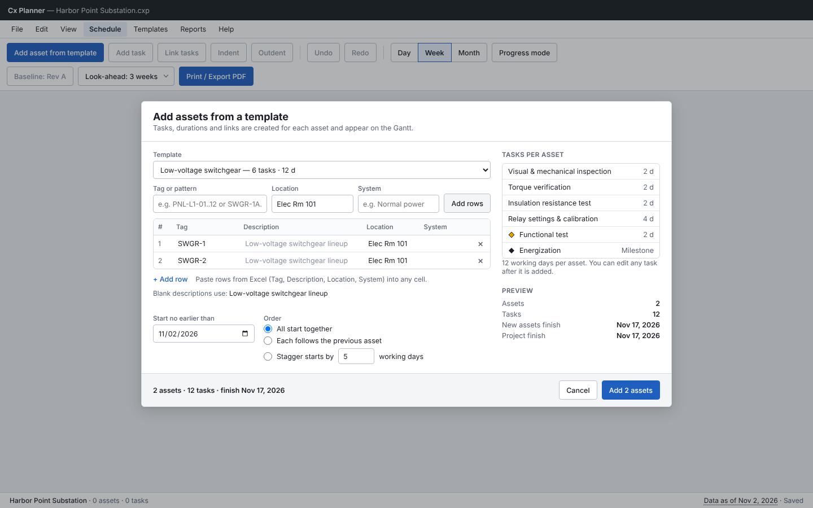
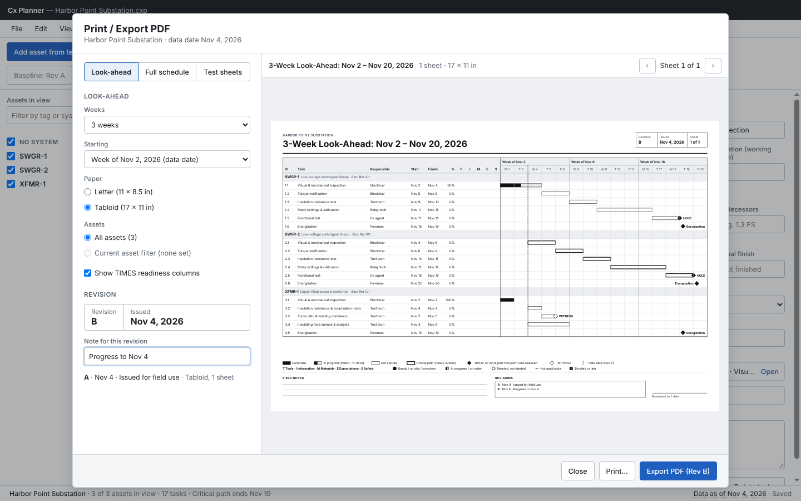
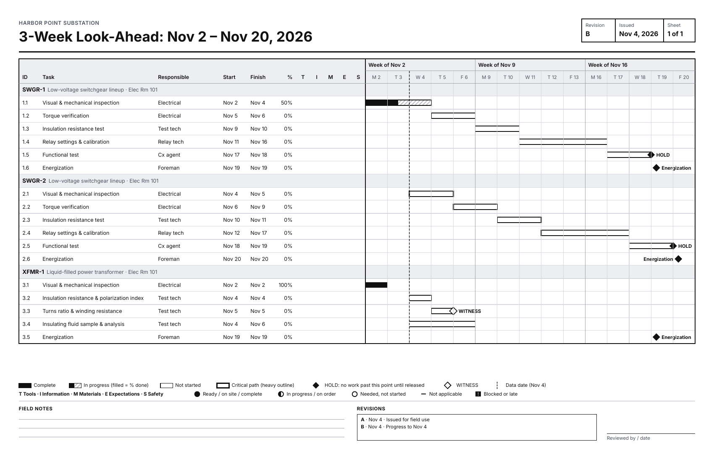
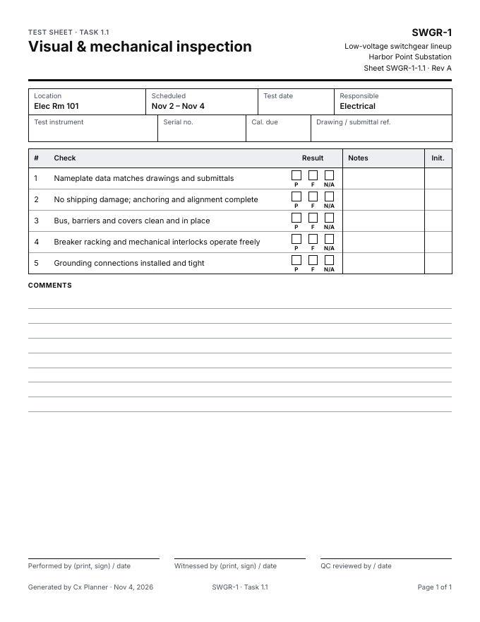

# M1 report: schedule, templates, look-ahead print

M1's goal (from [ROADMAP.md](ROADMAP.md)): **you can set up a real job, keep its schedule, and hand the field a revisioned look-ahead and blank test sheets every week.**

One end-to-end test walks exactly that story in the real Electron app, and CI runs it on every push: `apps/desktop/test/e2e/m1-flow.e2e.ts`. The screenshots below come from that run. All names, tags and dates are made up.

## What M1 delivers

| Area | What you can do |
|---|---|
| Project files | Start from the Welcome screen: New project, Open, Open recent, or Open sample project. A project is one `.cxp` file. Every edit is saved as you make it and written to the file's append-only change log; a backup copy is kept in `.cx-backups/` next to the file each time it is opened. A second PC opening the same file is refused while it is open. |
| Undo / redo | Every edit is one undo step (Ctrl+Z, Ctrl+Y or Ctrl+Shift+Z, the Edit menu, or the toolbar), including a whole "add assets" batch. |
| Templates | The template editor covers tasks, durations, predecessors, task types (task, hold point, witness point, milestone), trades and checklist items, with a live preview of the schedule a template generates. Eight starter templates ship with the app; duplicate one to make your own. Templates live in the workspace and can be exported and imported as files. Changes apply to new assets; **Re-apply to existing assets…** brings older assets up to date. |
| Add assets | Pick a template and type tags or a pattern (`SWGR-1..2`, `PNL-L1-01..12`), or paste rows from Excel. Assets can start together, follow each other or be staggered. Duplicate tags are flagged before anything is added. |
| Scheduling | Working-day calendar with holidays (project settings), CPM forward and backward pass, total float and the critical path, FS/SS/FF/SF links with lag, start-no-earlier-than, hold and witness points, and milestones. Progress-aware: unfinished work is scheduled from the data date. |
| Schedule view | Gantt grouped by asset; day, week and month zoom; task panel for editing; link, indent and outdent; asset filter sidebar; look-ahead window shading; legend with the readiness symbols (status never relies on colour alone). |
| Progress | % complete and actual start/finish in the task panel or in place in **Progress mode**. Setting 100 % asks for the actual finish. The data date is changed from the status bar. |
| Printing | **File → Print / Export PDF…** (Ctrl+P): 3-week look-ahead on Letter or Tabloid, full schedule on ANSI D or ARCH D, and blank test sheets (Letter, one per task with a checklist). Every print or PDF saves a print record with its revision letter and note; the next print of the same kind gets the next letter, and earlier revisions are listed on the sheet. |

## Try it

Requires Node 22+ and pnpm 10.

```bash
pnpm install
pnpm dev:desktop
```

Then either **Open sample project** on the Welcome screen, or follow the M1 story by hand:

1. **New project…**, give it a name and start date, and choose where to save the `.cxp` file.
2. **Edit → Add assets from template…**: pick *Low-voltage switchgear*, type `SWGR-1..2`, **Add rows**, **Add 2 assets**. Do it again with *Power transformer* and `XFMR-1`.
3. Select the transformer's *Energization* row and add the switchgear functional test (for example `1.5 FS`) to its **Predecessors**. The milestone moves after it.
4. Type a % complete on one task, an actual start and finish on another, then click **Data as of …** in the status bar and move the data date on.
5. Ctrl+Z and Ctrl+Y to undo and redo.
6. **File → Print / Export PDF…**: *Look-ahead*, *Tabloid*, **Export PDF (Rev A)**. Then *Test sheets*, **Export PDF (Rev A)**.
7. **File → Close project**, reopen it from **Recent projects**: everything is still there. Export the look-ahead again and it is **Rev B**, with Rev A listed in its revision box.

To run the end-to-end test yourself (Linux without a display uses `xvfb-run`; see the README):

```bash
pnpm desktop:e2e
```

The PDFs it exports are copied to `spike-output/desktop-e2e/m1-flow/`. In CI they are uploaded as the `m1-pdfs-linux` artifact, with all the e2e screenshots in `desktop-e2e-linux`.

## Screenshots

Schedule view after reopening the project: two switchgear lineups and a transformer, progress entered, data date Nov 4 (mockup board 1).



Template editor on the *Low-voltage switchgear* starter, used by the two lineups (mockup board 2).



Add assets from a template, with a tag pattern (mockup board 5).



Print / Export PDF, about to issue look-ahead Rev B on Tabloid.



The exported look-ahead PDF, Rev B, rendered to PNG (mockup board 3). It reads in black and white: progress is hatched, holds and witness points have their own symbols, and the data date is a dashed line.



The first blank test sheet from the same run (mockup board 4).



## Checks

- `pnpm lint && pnpm typecheck && pnpm test`: 501 unit tests in 40 files.
- `pnpm desktop:e2e`: 37 Electron UI tests in 11 files, including the M1 flow. About a minute on the CI Linux runner, under `xvfb-run` with `--no-sandbox`.

## Notes and known gaps

- The undo history covers the current session; it starts empty when a project is reopened (the change log in the file keeps every edit).
- A milestone sits at the start of the working day after its predecessor finishes, while "Critical path ends …" in the status bar names the last working day of work. So a project whose last item is an energization milestone on Nov 20 shows "Critical path ends Nov 19". This is the scheduling engine's documented convention; worth deciding in M2 whether the status bar should name the milestone date instead.
- The **Baseline** button on the Schedule toolbar is a placeholder until baselines arrive in M2.
- Still to confirm by you: print the Tabloid look-ahead and a test sheet on the office printer, and open one project from the shared drive on two PCs.
